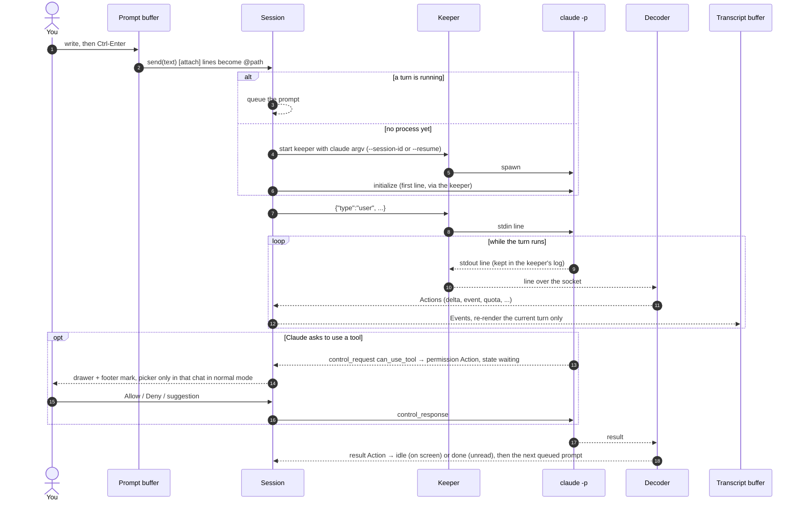
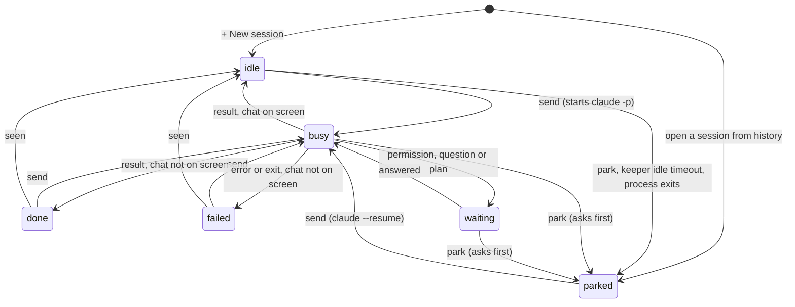
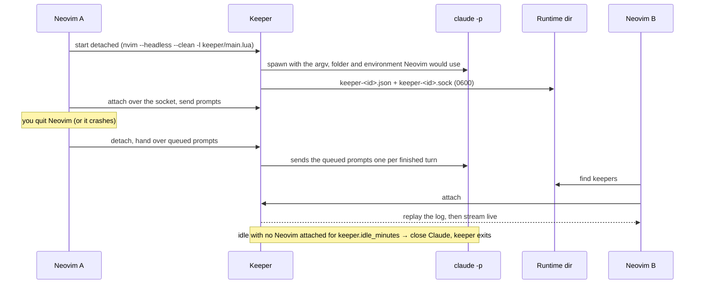
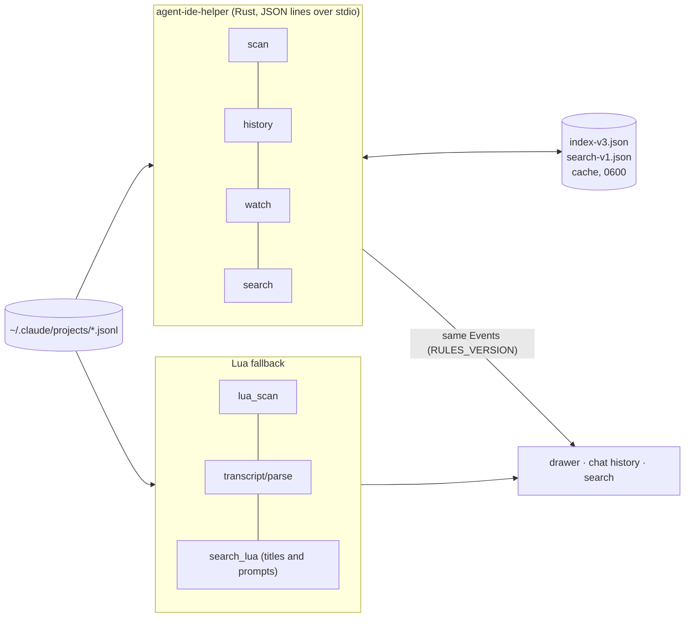
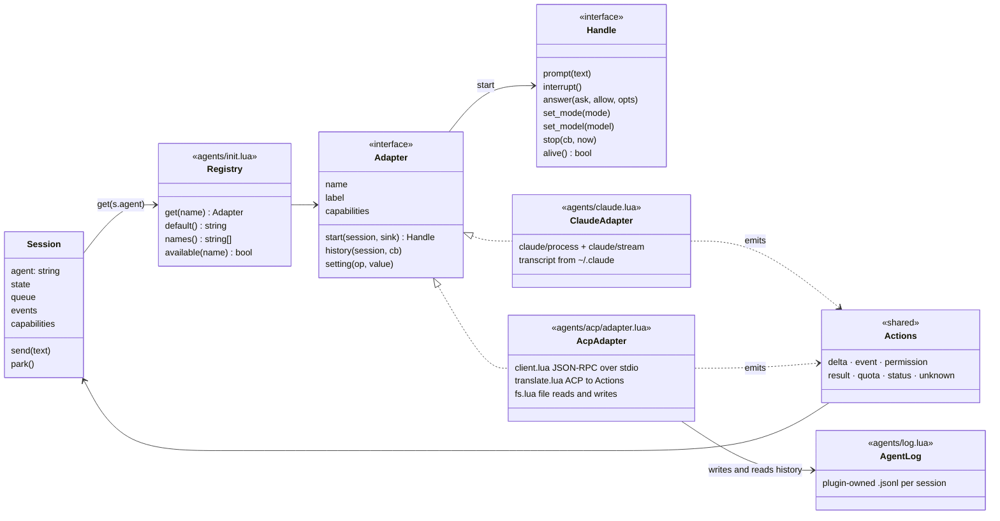

# Architecture

How Agent-IDE.nvim is put together: the pieces, how a prompt travels, the states a session goes through, how Claude keeps running after Neovim quits, and the agent abstraction that lets other agents plug in later. For the wire format see [`docs/protocol.md`](docs/protocol.md); for the rules every change follows see [`AGENTS.md`](AGENTS.md).

## In one paragraph

Agent-IDE is two halves around one source of truth. The **read side** never runs a model: it reads the transcripts Claude Code writes to `~/.claude/projects/*.jsonl` (through a Rust helper, or a Lua fallback), asks `claude agents --json` which sessions run elsewhere, and asks git what changed. That fills the drawer, the history, search, diffs and the commit graph. The **drive side** starts one `claude -p` per session that you chat in, speaking line-delimited JSON over stdin and stdout, usually through a small detached **keeper** process so Claude outlives Neovim. A pure decoder turns Claude's stream into a small set of **Actions**, a **Session** object turns Actions into **Events** and a state, and the UI renders Events as a markdown transcript. Nothing Claude sends is dropped: what is not understood shows as an `unknown` fold, and the raw view keeps every byte.

## The pieces

The overview diagram is in [README.md](README.md#the-architecture).

The modules used:

| Module | Job |
|---|---|
| `claude/process.lua` | one long-lived `claude -p` child: spawn, write a line, read lines, stop (close stdin, SIGTERM after 500 ms). No protocol knowledge |
| `claude/stream.lua` | Claude's stream objects → Actions (`init`, `delta`, `event`, `permission`, `result`, `quota`, `unknown`, …). Pure |
| `session/object.lua`, `session/actions.lua` | the Session: prompt queue, state machine, pending asks, model and mode requests; reacts to Actions and to the process exit |
| `keeper/` | the detached process that owns Claude's pipes, its socket client, discovery of running keepers |
| `transcript/parse.lua`, `render.lua`, `live.lua` | transcript lines → Events (the same rules as the Rust parser), Events → markdown lines and folds, the live buffer that only rewrites the current turn |
| `index/`, `helper/` | scan, history, file watching and search, in Rust over stdio with a Lua fallback |
| `git*.lua` | read-only git (`--no-optional-locks`), parsed by pure functions, cached |
| `live.lua` | which sessions run in another terminal (`claude agents --json` every 5 s) |
| `status.lua` | the overall level, the statusline text, `status-<pid>.json` for the bar |
| `ui/` | everything you see; pure layout (`tree.lua`, `layout.lua`, `graph_render.lua`) is kept apart from windows |

## Sending a prompt

The prompt is sent byte for byte. The only change is that an `[attach] <path>` line outside a code fence becomes Claude Code's own `@<path>` mention. Model, mode and interrupt are control requests on the same pipe (`set_model`, `set_permission_mode`, `interrupt`); a setting chosen while no process runs is deferred and sent when it starts.

## Session states

Every session in the drawer, the winbar and the footer has one of these states. The diagram is the Session's own machine (`session/object.lua`, `session/actions.lua`).

Labels the UI adds on top, without changing the Session's state:

- `elsewhere`: `claude agents --json` lists the session with a process the plugin did not start (a terminal). Sending is refused, so two Claudes never drive one session.
- `native`: handed to `claude --resume` in a tmux pane with `gT`. The session is parked here and reloaded from disk when that pane ends.
- `background` / `input`: a keeper holds the session's Claude, and no Neovim is attached; `input` means it waits for you.

## Keepers: Claude outlives Neovim

The keeper is a headless Neovim running one Lua file, so it needs nothing that is not already installed. It keeps the last 5000 lines sent and received. A Neovim that attaches feeds the replayed lines through the same decoder the live chat uses, so the transcript, open asks, model, mode and state come back exactly as they were. Only one Neovim drives a session at a time. `keeper = { enabled = false }` makes Claude a plain child of Neovim again.

## The read side

The helper starts on the first request and says hello with its `rules_version`; a helper that follows other rules is treated as out of date and the Lua path takes over. The Lua parser and the Rust parser must produce the same Events, enforced by parity tests. Scanning and reading long histories happen off the UI thread in Rust; the Lua fallback works in short time slices so the editor never blocks.

## Abstractions for other agents (the `acp` branch)

`main` drives Claude Code only. The parked [`acp`](../../tree/acp) branch has the refactor that makes the agent swappable, built so the Session and the UI never name Claude:

The ideas behind it:

- **One action model.** Every adapter translates its own wire into the same Actions the Claude decoder already produced. The Session, the transcript renderer, permissions and the status never learn which agent runs. The Claude adapter was a pure refactor: the existing tests had to pass unchanged.
- **Capabilities drive the UI.** Each adapter declares what it can do (`resume`, `modes`, `models`, `commands`, `interrupt`, `quota`, `native`, `live`, `transcript`, `images`). Claude has all of them except `images`; an ACP agent starts with almost none and gains `resume`, `modes` and `models` from its handshake. A missing capability hides its winbar segment and turns its key into a one-line notice.
- **ACP for everything that is not Claude.** The [Agent Client Protocol](https://agentclientprotocol.com) is JSON-RPC over stdio: `initialize`, `session/new` or `session/load`, `session/prompt` (open for the whole turn), `session/cancel`, `session/update` notifications and `session/request_permission`. A new agent is a config entry, not code: `agents.<name> = { kind = 'acp', cmd = {...} }`. Gemini CLI and opencode worked with limits; Codex needs an ACP adapter such as Zed's `codex-acp`.
- **A plugin-owned history where the agent has no readable transcript.** ACP agents' sessions are logged as Events to `stdpath('state')/agent-ide/sessions/<agent>/<id>.jsonl` and merged into the drawer and search.
- **Explicit about cost.** If an agent cannot reload a session, the transcript continues with a visible notice. Replaying the earlier conversation into the new agent session (`replay_context`) is off by default because it costs tokens.

The branch is parked, not abandoned: `main` has moved on since (keepers, colour codes in tool output, …), so reviving it means rebasing the adapter seam onto today's Session.

## Key implementation choices

- **The CLI, not the API.** Claude runs through `claude -p` on your subscription; `ANTHROPIC_API_KEY` is removed from every child's environment. The plugin reads no credentials and makes no network calls of its own. Settings, `CLAUDE.md`, hooks, skills and MCP servers apply exactly as in a terminal.
- **The transcripts are the database.** The drawer, history and search come from the files Claude Code already writes. The plugin keeps only caches, drafts, prompts and small preference files, all `0600` in `0700` folders, written atomically.
- **Pure cores, thin shells.** The stream decoder, the transcript parser and renderer, git parsing, the tree and the graph layout are pure functions tested without a window; process and window code stays thin around them.
- **Fidelity over prettiness.** Nothing is dropped silently: unknown objects become `unknown` folds, cut lines carry a counted marker, colour codes in tool output render as colours, and `gr` shows every line sent and received.
- **Never interrupt typing.** Asks, finished turns and errors wait in the drawer and the footer; no popup, focus change or cursor move while you type. A soft chime is the only push.
- **Speed is tested.** Budget tests hold the drawer under 50 ms with 60 projects and a 1 MB history under 150 ms with the helper; nothing synchronous runs on a keystroke, and git and scanning never block the UI.
- **Works without the helper.** Every helper feature has a Lua fallback; only search is reduced there.
- **Read-only git.** Changes, commits, diffs and the graph only read; staging and committing are left to lazygit.
- **Hands off processes it did not start.** The plugin never signals a Claude it did not start. The one exception, closing an idle Claude in a tmux pane, types Claude's own exit keys after a confirm and a fresh check that the pane still runs that session.
- **No plugin dependencies.** Neovim 0.12+ only; integrations such as lualine or a markdown renderer are optional and guarded.
