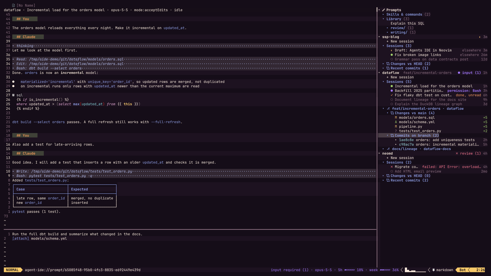
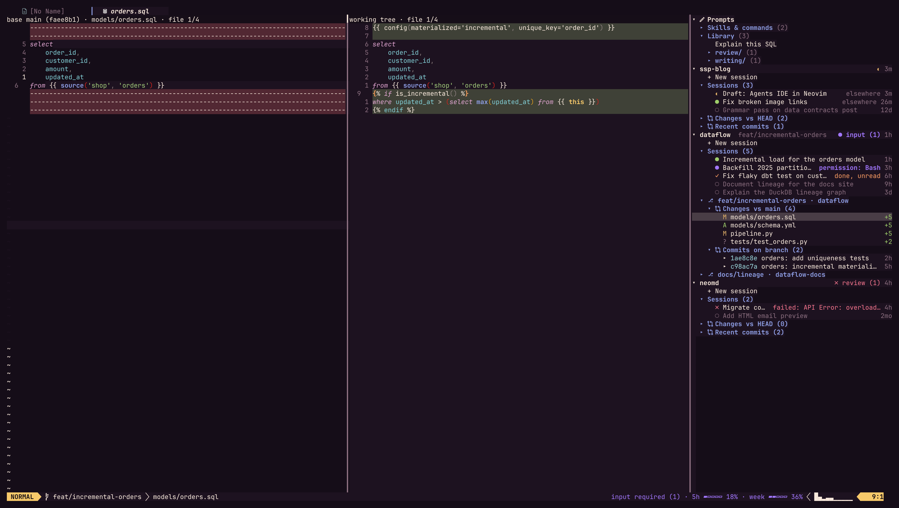
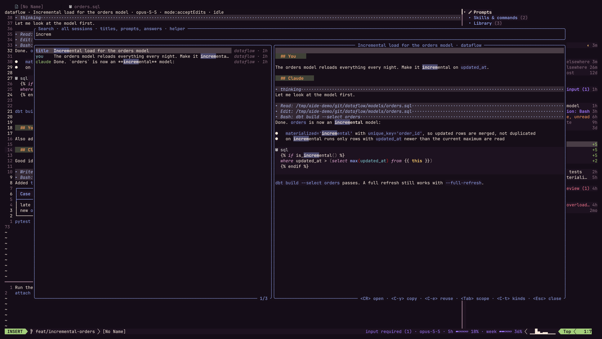
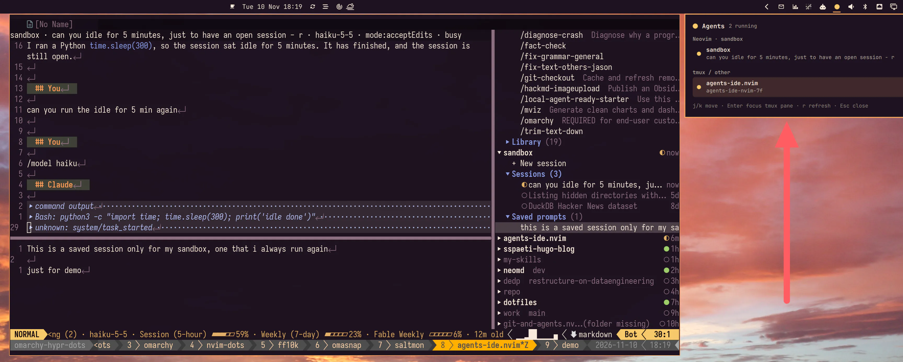

# Agent-IDE.nvim (Agents Drawer)

A Neovim plugin to run and review all your Claude Code sessions from one place: a drawer lists every session grouped by git repository, you chat in native buffers (a prompt buffer to write, a markdown buffer to read), and you review what the agent changed with git diffs, without leaving Neovim.


## Why I built Agent-IDE?

Agent-IDE.nvim is my new plugin for agent handling in Neovim, optimized for [my terminal workflow](https://www.ssp.sh/brain/my-terminal-workflow-with-macos-and-linux/). I saw a tweet, [`Herdr or Rex`](https://x.com/omarmsimon/status/2120013311681130603), and then I thought, why not in Neovim? Below is what came out of that question.

Coding is changing, from writing to more navigating and viewing changes, etc. So Neovim is great for all of it, I use nvim with lazygit for seeing all the changes and navigating around changes the agents made. So I thought, why not make it the main control center, as I did for email with [Neomd](https://github.com/ssp-data/neomd), where nvim is the composer.

I want to prompt in neovim (I use `ctrl-g`) for Claude Code anyway to type with my shortcuts [Vim Motions](https://www.ssp.sh/brain/vim-language-and-motions/) and also my snippets and superpowers, and the rendering of responses from Claude Code looks awful, unlike my rendering of Markdown within neovim. So why not use neovim to write and also show the responses in a buffer of Neovim that renders Markdown nicely? That was the premise, and the outcome looks like this:



What you see, from right to left. **The drawer** shows the `Prompts` node (library, skills and commands) and every project with its sessions in all states: running elsewhere (`elsewhere`), waiting for a permission (`permission: Bash`), done and not read yet (`done, unread`), failed (`failed: API Error…`), idle and parked (dimmed). A project row sums its sessions up (`input (1)`, `review (1)`). Below the sessions are a branch's `Changes vs main` and `Commits on branch`, and a second worktree. **The chat** fills the main window: a rendered markdown transcript with tool calls (`Read`, `Edit`, `Bash`, `Write`) and thinking folded, and a winbar with project, title, model, permission mode and state. **The prompt buffer** below holds a draft with an `[attach]` line. **The footer** in lualine shows the overall state, the model and the quota.

The diff view: what the agent changed on the branch, side by side, with your real file on the right:



The search across all sessions, with a rendered preview of the hit:



The screenshots use synthetic demo sessions and repositories.



s
## Focus
The features and focus are on managing all agent sessions in a single drawer, as I use [Query databases in vim (vim-dadbod)](https://www.ssp.sh/brain/query-databases-in-vim-vim-dadbod/) to query databases within nvim, that's why it's called the **Agent IDE** because it's my IDE for agents.

### Why not a Terminal TUI, why Neovim?
You might ask why not a terminal-based TUI, now that Herdr, Rex, and others are built in the terminal for agents, or even apps nowadays. The reason is that nvim is doing most of the things I like to improve anyway, and I have a 5+ year history of dotfiles for nvim, where I optimized these aspects over the years already - things like: 
- beautiful markdown rendering
- modal typing and fast moving around
- git integration with lazygit and other shortcuts
- the place to navigate and being an IDE for agents, as it has so many functionalities and is super extensible and composable

## Features
- **One drawer for all sessions**, grouped by git repository, with live state: input required, running, done, idle
- **Chat in native buffers**: write prompts with your own Vim setup, read answers as rendered markdown, tool calls folded
- **Never interrupts typing**: permission requests and finished sessions wait; one key jumps to the next one
- **Git review built in**: changes and commits per project, side-by-side diffs, jump from an edit to its diff
- **Fuzzy search** across all sessions and every prompt you ever sent
- **Reusable prompts**: a prompt library, skills and commands, saved prompts per project
- **Status in your statusline** (and an Omarchy bar widget): state, model, quota
- **Uses your Claude subscription** through the Claude Code CLI; no API key
- **Fast**: Rust helper for scanning, search and file watching, with a Lua fallback


## Status

Parts 1 to 5 of 6 and search are done: the drawer and the history view, chat with Claude Code from Neovim, reusable prompts, git review (what an agent changed, with a diff view), the Omarchy indicator (see `omarchy/io.github.sspaeti.agent-ide/README.md`), and search across all sessions. Other agents (part 6) are planned and not available yet.

## Prerequisites

| What | Needed | What for |
|---|---|---|
| Neovim 0.12 or newer | required | |
| Claude Code, logged in with a subscription | required | The plugin reads the transcripts Claude Code writes to `~/.claude/projects`, asks `claude agents --json` which sessions are running, and runs `claude -p` for the chat (and `claude --resume` in a tmux pane for native Claude). Tested with Claude Code 2.1.306 |
| `git` | recommended | The `Changes` and `Commits` sections and the diff view. Grouping sessions by repository reads the `.git` folders and works without it |
| A [Nerd Font](https://www.nerdfonts.com) in the terminal | recommended | The default icons (`icons_style = 'nerd'`). Without one, set `icons_style = 'plain'` |
| Extended keys in the terminal (and in tmux) | recommended | `<C-CR>` sends the prompt only when the terminal, and tmux if you use it, pass `<C-CR>` on to Neovim; see [Settings you may need](#settings-you-may-need). `<leader><CR>` sends without it |
| Treesitter parsers `markdown` and `markdown_inline` | recommended | Highlighting in the transcript, which is a `markdown` buffer, when treesitter highlighting is on for markdown (Neovim bundles both parsers; keep them if a plugin manages your parsers) |
| A markdown render plugin | optional | Nicer answers in the transcript; any plugin that renders `markdown` buffers works |
| lualine, or any statusline | optional | The footer with the state of all sessions and the quota (see [Footer](#footer)) |
| `cargo` | optional | Builds the Rust helper: fast scanning, file watching and fuzzy, typo-tolerant search. Without it a Lua backend scans on a timer and search is limited to titles and prompts, exact words only |
| `tmux` | optional | `gp` jumps to the pane of a session running elsewhere (the drawer then shows its pane, `tmux 2.1`), and `<leader>at` continues a chat in native Claude in a tmux pane |
| `lazygit` | optional | `glg` in the drawer and the diff view |
| A `vim.ui.select` provider such as Snacks or Telescope | optional | Nicer pickers (permissions, model, prompts); the built-in one works |
| A clipboard provider | optional | Copying a search hit (`<C-y>`) and yanking a prompt (`y`) also to the `+` register |

### Settings you may need

For `<C-CR>` inside tmux, add to `~/.tmux.conf` (and restart the tmux server):

```tmux
set -s extended-keys on
set -as terminal-features 'xterm*:extkeys'
```

For the footer in lualine, see [Footer](#footer). After updating the plugin, run `make helper` in the plugin folder (or let your plugin manager run its build step) so the helper matches the Lua code; until then the plugin says so and uses its Lua backend.

## Install

With [lazy.nvim](https://github.com/folke/lazy.nvim):

```lua
{
  'ssp-data/agent-ide.nvim',
  build = 'make helper', -- optional; needs cargo
  cmd = 'Agents',
  keys = { { '<leader>aa', '<cmd>Agents<cr>', desc = 'Agent-IDE: toggle drawer' } },
  opts = {},
}
```

Without `cargo` leave out `build`; the plugin uses its Lua backend. If Neovim says that the helper is out of date, the helper binary was built from older sources than the plugin (both must read transcripts by the same rules); see [Settings you may need](#settings-you-may-need).

Lazy-loaded on `cmd = 'Agents'` (or the key above), the plugin starts with the first `:Agents`: until then the other global keys (`<leader>an`, `<leader>as`, `<leader>aP`), `:AgentsSearch`, the footer and the status file for a desktop bar do not exist yet. To have them from the start, load it after startup instead:

```lua
{
  'ssp-data/agent-ide.nvim',
  build = 'make helper',
  event = 'VeryLazy',
  opts = {},
}
```

## Configuration

These are the defaults. Pass only what you want to change to `setup()` (or `opts`).

```lua
require('agent-ide').setup({
  projects_dir = vim.fn.expand('~/.claude/projects'),
  drawer = { width = 44, side = 'right', legend = true }, -- legend: the state marks at the bottom (gL)
  live = { interval_ms = 5000, cmd = { 'claude', 'agents', '--json' } },
  helper = { enabled = true, path = nil }, -- nil: <plugin root>/helper/target/release/agent-ide-helper
  claude = {
    cmd = { 'claude' },     -- executable and leading arguments for the chat process
    strip_api_key = true,   -- remove ANTHROPIC_API_KEY from the environment of every Claude it starts
    model = nil,            -- model for new sessions (nil: Claude's default)
    version_check = true,   -- one notice when the installed Claude Code is not the tested version
    modes = { 'manual', 'acceptEdits', 'plan', 'auto' }, -- what <S-Tab> cycles through
    default_mode = nil,     -- where the cycle starts before Claude reports a mode
    models = { 'fable', 'opus', 'sonnet', 'haiku' },     -- what the model picker offers
  },
  tcd = true, -- opening a session sets the tab's working directory to its project
  -- each key option is a key, a list of keys, or false (no mapping); keys = false turns off all of
  -- these. Fixed, not configurable: the drawer's own keys, q / <Esc> in help floats, q in the raw
  -- view, ]c / [c in the diff view, and / and @ in the prompt (chat.auto_slash, chat.at_picker)
  keys = {
    toggle = '<leader>aa',
    next_waiting = '<leader>an',
    search = '<leader>as', -- search all sessions
    prompt_history = '<leader>aP', -- every prompt, newest first
    -- the search picker's query line; close works in normal mode (insert-mode <Esc> leaves insert mode)
    search_picker = { next = { '<C-n>', '<Down>' }, prev = { '<C-p>', '<Up>' }, open = '<CR>', copy = '<C-y>',
      reuse = '<C-e>', scope = '<Tab>', kinds = '<C-t>', close = { '<Esc>', 'q' } },
    chat = { send = '<C-CR>', send_alt = '<leader><CR>', interrupt = '<C-c>', prompt = '<leader>ap', help = 'g?',
      history_prev = '<C-p>', history_next = '<C-n>', attach = '<leader>af',
      answer_inner = 'ir', answer_outer = 'ar', mode = '<S-Tab>', model = '<leader>aM', answer = '<leader>ay',
      raw = 'gr', raw_event = 'gR', native = '<leader>at', park = '<leader>ax', diff = { 'gd', '<leader>gd' },
      save_library = '<leader>W', prompts = '<leader>al' },
    -- diff view, on both sides; a one-character key (q, ?, R) only on the left side, since the
    -- right side is your own file, where they stay macro recording, search and Replace mode
    diff = { next_file = { ']f', '<leader>gj' }, prev_file = { '[f', '<leader>gk' }, flip = { 'gb', '<leader>gt' },
      branch = { 'gB', '<leader>gB' }, close = { 'q', '<leader>gq' }, help = { '?', 'g?' },
      refresh = { 'R', '<leader>gR' }, lazygit = 'glg' },
    -- drawer, on prompt rows (elsewhere these keys keep their normal meaning)
    prompts = { edit = 'e', rename = 'r', delete = 'd', yank = 'y', to_library = 'L' },
  },
  prompts = {
    library_dir = nil,  -- your templates (nil: stdpath('data') .. '/agent-ide/library')
    saved_dir = nil,    -- per-project saved prompts (nil: stdpath('data') .. '/agent-ide/prompts')
    command_dirs = { '~/.claude/commands' }, -- Claude's commands (read only)
    skill_dirs = { '~/.claude/skills' },     -- Claude's skills (read only)
    project_dirs = true, -- also <project>/.claude/commands and /skills of the chat's project
  },
  quota = { file = nil }, -- footer quota from a file another tool writes (see Footer); nil: off
  trash = { keep_days = nil }, -- deleted sessions (D) older than this are purged at setup; nil: kept until :AgentsTrash empty
  chat = { auto_slash = true, at_picker = true }, -- `/` opens the command menu, `@` the file picker
  icons_style = 'nerd', -- 'nerd' (needs a Nerd Font) or 'plain' (characters of any monospace font)
  icons = {}, -- override single icons of that set, for example { busy = '*', changes = '' }; '' hides one
})
```

Icon keys: `open`, `closed` (fold arrows), `prompts`, `changes`, `commits`, `worktree`, and the session states `waiting`, `busy`, `idle`, `parked`, `done`, `failed`. Both sets use `▾ ▸` for folds, `⎇` for a worktree and the characters `● ◐ ● ○ ✓ ✗` for waiting, busy, idle, parked, done and failed (waiting and idle differ by colour). The nerd set differs in two places only: a pencil glyph (nf-md-pencil_outline) on the Prompts row and one git glyph (nf-oct-git_compare) on both the `Changes` and `Commits` rows. Nothing else carries an icon: no project icon, no section icons, no per-kind prompt icons.

`:Agents` (or the toggle key) opens the Agents tab with the drawer. Inside the Agents tab it closes or reopens the drawer; from any other tab it switches to the Agents tab.

## Drawer

The drawer has no header line; `?` lists every key. Each row shows its state mark and title on the left and, aligned to the right edge, what needs you and how old it is; a title too long for the drawer is cut with `…`, the right part never.

| Row | Right part |
|---|---|
| Session waiting for you | `permission: <tool>`, `question` or `plan to approve` (in another Claude: `input`) |
| Session done or failed while you were elsewhere | `done, unread`; `failed`, with the start of the error when there is one |
| Session running in another Claude | `tmux <window>.<pane>` when Neovim runs inside tmux and the session in one of its panes, else `elsewhere`; handed to native Claude: `native` |
| Project | the state icon of its most urgent session; `input (n)` while sessions wait, `review (n)` for done or failed ones; then the age of its newest session |
| Changed file, commit | `+added −removed`, the commit's age |

Ages read `now`, `5m`, `3h`, `12d`, then months (`14mo`) and years (`2y`). Colours: waiting violet (bold), busy yellow, idle green, done orange, failed red, parked rows (mark, title, age) and ages dimmed, never italic; the groups are `AgentIdeWaiting`, `AgentIdeBusy`, `AgentIdeIdle`, `AgentIdeDone`, `AgentIdeFailed`, `AgentIdeParked`, `AgentIdeAge` and `AgentIdeSection`, and a colorscheme can set them. The dim groups (`AgentIdeParked`, `AgentIdeAge`, `AgentIdeMissing`, `AgentIdeBranch`, `AgentIdeGitUntracked`) take the foreground of `Comment` at setup and on every `ColorScheme`, without italic or bold. A project row is its fold arrow and bold name; a parked project's name is dimmed. A project whose folder is gone says `(folder missing)`; a session started in a sub-folder of its project shows `<subfolder>/ · <title>`.

**Legend.** The bottom of the drawer explains the state marks: `● input  ◐ running  ● idle  ○ parked  ✓ done  ✗ failed`, each mark in its colour (the marks of your icon set), over one or two lines. It stays put while the list scrolls, never takes the focus and never covers the cursor row (the list scrolls instead). It hides itself while the drawer is shorter than 12 lines or narrower than 24 columns. `gL` shows or hides it; `drawer = { legend = false }` starts with it hidden.

**Hidden sessions.** `H` on a session row hides it: nothing is deleted, the session only moves into a collapsed, dimmed `Hidden (n)` group, the last row of its project's `Sessions (n)` section (which counts the visible ones only). `<CR>` or `za` expands the group; its rows open like any other session, and `H` on one shows it again. Hidden sessions do not count for the project's age, order or state mark, except while one needs you: a hidden session that is waiting, busy, done-unread or failed is listed among the normal rows (and counted in the roll-up, the footer and `<leader>an`) for as long as that lasts. A project whose sessions are all hidden still shows, with `Sessions (0)` and its group. Search finds hidden sessions as usual. The list is kept in `hidden.json` (see [Privacy](#privacy)); several Neovims share it.

### Deleting sessions

Claude Code has no command to delete one session. `D` on a session row (also in a `Hidden` group) moves what Claude keeps of it into the plugin's trash, after a confirm (default: no). Claude's folder is the parent of `projects_dir` (by default `~/.claude`). Moved, when present:

- the transcript `projects/<slug>/<id>.jsonl` and the folder beside it, `projects/<slug>/<id>/` (subagents, tool results);
- `file-history/<id>/`, `session-env/<id>/`, `tasks/<id>/`;
- the lines of `history.jsonl` that belong to the session (the prompts you typed); every other line stays byte for byte, and lines Claude appends while it is rewritten are not lost.

Not removed: pasted-text cache files (`paste-cache/`), usage statistics (`stats-cache.json`) and settings. Only an inactive session can be deleted: `D` is refused while the session is active in this Neovim (park it first with `x`), handed to native Claude, running in another Claude (asked afresh with `claude agents --json`; when that fails, nothing is deleted), or while its prompt holds unsent text. Its chat and raw buffers are closed and it leaves `hidden.json`.

The trash is `stdpath('data')/agent-ide/trash/<YYYYMMDD-HHMMSS>-<id>/` (folder `0700`; files keep their modes): the moved entries in their layout, `history.jsonl` with the removed lines and `manifest.json` (where each entry came from, title, project, time). **The trash still holds the whole session**, prompts and answers included, until you empty it: for sensitive data run `:AgentsTrash empty` afterwards. `:AgentsTrash` lists the trashed sessions to restore one (refused when something is at its old place; the history lines go back in time order) or delete it for good; `:AgentsTrash empty` deletes all of them for good after a confirm. Nothing is purged automatically unless you set `trash = { keep_days = 30 }`, which purges older entries at setup.

### Closing terminal sessions

`X` on a session row that runs in another Claude in a tmux pane (the row shows `tmux <window>.<pane>`) ends that Claude the way you would there: after a confirm (default: no) it types Ctrl-C into the pane, and again 300 ms later (Claude's own exit). Right before, it checks again that the pane still exists and still runs that Claude, so the keys never land in a pane that meanwhile runs something else; the process itself is never signalled. A session that is working or waiting for input asks a second time. If Claude still runs 5 s later, a notice says so and nothing more happens. Outside tmux, or when the pane is not known (`elsewhere`), `X` says it cannot reach the session; for a session running in this Neovim use `x`. `:AgentsCloseIdle` closes every Claude that is idle in a tmux pane, after one confirm with their count.

## Keys

Global:

| Key | Action |
|---|---|
| `<leader>aa` | Toggle the Agents tab (same as `:Agents`) |
| `<leader>as` | Search all sessions (`:AgentsSearch [query]`) |
| `<leader>aP` | Prompt history: every prompt you sent, newest first |
| `<leader>an` | Go to the next session that needs you: one waiting for your answer here (oldest ask first), then one waiting in another Claude (jumped to in tmux), then a failed turn, then a finished turn you have not seen; from the first of them, the one after it |

In the drawer:

| Key | Action |
|---|---|
| `<CR>`, `o` | Expand or collapse a project; open a session; start a new session (`+ New session`; pressed again while that one has sent nothing, it comes back with its draft; `2<CR>` starts a separate one); use a prompt |
| `za` | Expand or collapse the node under the cursor |
| `zM` | Collapse all: only the top-level rows remain (a project opened again shows its sessions) |
| `zR` | Expand all projects with their `Sessions`; `Changes`, `Commits`, `Saved prompts`, `Hidden` and the Prompts node stay as they are (opening them loads git or prompts for every project). `zR` again, with nothing changed in between, opens everything (a commit's own file list excepted). Git counts of closed sections load a few projects at a time |
| `R` | Rescan sessions and refresh running state |
| `gp` | Jump to the tmux pane of a session running elsewhere |
| `s` | Search the sessions of the project under the cursor |
| `x` | Park the session: stop the Claude process this Neovim runs for it |
| `H` | Hide the session into its project's `Hidden (n)` group; on a hidden session: show it again (Vim's `H` motion is not available in the drawer) |
| `D` | Delete an inactive session: move it to the plugin's trash after a confirm (see [Deleting sessions](#deleting-sessions)) |
| `<leader>aM`, `<S-Tab>`, `<C-c>`, `<leader>at`, `gr` | On a session row, what they do in its chat, for that session and without opening it: pick the model, next permission mode, interrupt (only while Claude works), continue in native Claude in a tmux pane, raw view in the main window. A session without a process takes the mode or model when it starts; one running in another Claude is refused (the raw view still opens). On other rows `<S-Tab>` and `<C-c>` keep their Vim meaning |
| `X` | Close the Claude that runs the session in a tmux pane, after a confirm (see [Closing terminal sessions](#closing-terminal-sessions)) |
| `q` | Close the drawer |
| `gL` | Show or hide the legend of the state marks |
| `glg` | Open lazygit for the row's repository (a worktree row or session: that worktree) |
| `?`, `g?` | Help (`/` searches in it, `q` or `<Esc>` closes it) |
| `e` | Prompt row: edit its file in the main window (Claude's commands and skills open read-only) |
| `r` | Prompt row: rename (library: `group/name` moves it to another group) |
| `d` | Prompt row: delete the file (asks first) |
| `y` | Prompt row: yank its text (unnamed and `+` registers) |
| `L` | Saved prompt row: copy it into the library (asks for a name) |

The prompt row keys are under `keys.prompts`; elsewhere in the drawer they keep their Vim meaning, and a drawer key above always wins over one of them. The session row keys are the chat's (`keys.chat`), so a remap applies to both. The other drawer keys are fixed.

In the chat (transcript and prompt buffer, unless noted):

| Key | Action |
|---|---|
| `<C-CR>` | Send the prompt (normal and insert mode) |
| `<leader><CR>` | Send the prompt |
| `<C-c>` | Normal mode: interrupt Claude; queued prompts come back into the prompt buffer |
| `<leader>ap` | Focus the prompt |
| `i`, `a`, `o` | Transcript: write in the prompt |
| `<leader>ay` | Answer what Claude asks (permission, question, plan) |
| `<S-Tab>` | Next permission mode |
| `<leader>aM` | Pick the model |
| `<leader>ax` | Park the session: stop its Claude process (asks when it is working); the next send resumes it |
| `<leader>at` | Continue the session in native Claude in a tmux pane; while it is there, take it back |
| `gr` | Transcript: raw view of what was sent and received; `q` or `gr` returns |
| `gR` | Transcript: raw view at the line of the `unknown` fold under the cursor |
| `ir`, `ar` | Transcript: text object for one Claude answer (`ar` with its header) |
| `gd`, `<leader>gd` | Transcript, on an `Edit` or `Write` fold: the branch diff of that file |
| `<C-p>`, `<C-n>` | Prompt: older or newer prompt (also `<Up>` on the first line, `<Down>` on the last) |
| `<leader>af` | Prompt: pick a file and add an `[attach]` line |
| `/` | Prompt, on an empty line: the command menu; typing narrows it (fuzzy), nothing is inserted until you choose (`<C-n>`, `<C-y>`) |
| `@` | Prompt, after a space: pick a file to attach |
| `<leader>al` | Pick a prompt: saved prompts, library, Claude's commands and skills |
| `<leader>W` | Prompt: save it to the library (asks for a name; `group/name` makes a folder) |
| `:w`, `:x`, `ZZ` | Prompt: save it (see [Prompts](#prompts)); `:x` and `ZZ` then hide the window |
| `za` | Toggle fold |
| `:q` | Prompt: hide the window; the draft stays |
| `:q!` | Prompt: hide the window and discard the draft |
| `g?` | Help (`?` stays Vim's backward search) |

The history buffer is markdown with folds for tool calls, results and thinking. Anything the viewer does not understand is shown as a fold marked `unknown`, never dropped, and truncated output says how many lines are hidden.

## Chat

Open a session from the drawer, or start one with `+ New session` under a project. The transcript fills the main window of the Agents tab and a prompt buffer opens below it. Opening a session shows its history without starting Claude; the first prompt you send starts `claude -p` for it (resuming the session when it has a history), and the process keeps running until you park the session (`<leader>ax`, or `x` in the drawer), hand it to native Claude, or quit Neovim. Parking asks first when Claude is working, puts queued prompts back into the prompt buffer, and keeps the transcript; the next prompt resumes the session. The winbar shows the state as the drawer does (its mark and word in the same colours: `● permission: Bash`, `◐ busy`, `✓ done, unread`, `✗ failed: <reason>`, `◐ tmux 2.1`), the number of queued prompts, the project in bold and the title, and on the right the model in italic (`AgentIdeModel`) and the permission mode as a badge (`[manual]` in `AgentIdeMode`; any other mode, such as `[acceptEdits]`, `[plan]`, `[auto]` or `[bypassPermissions]`, in `AgentIdeModeHot`, linked to `WarningMsg`). It fits its window: the title is cut with `…` first, then the model, the queue count and the badge give way (the project takes what is left), and only last the state word is cut.

**Prompt buffer.** A normal markdown buffer: write as much as you like and send it with `<C-CR>`. Its text is sent as typed, except that an `[attach] <path>` line outside a fenced code block (a fence starting at column 0) becomes `@<path>` (`@"<path>"` when the path holds spaces), which makes Claude read the file. `@` after a space opens a file picker that adds such a line; `/` on an empty line opens the command menu: the commands the session listed and the commands and skills the Prompts node finds on disk and, on top, two of the plugin's own, marked `plugin`: `/model` opens the model picker and `/copy` copies the last answer to the unnamed and `+` registers. They act when chosen from the menu or sent as the whole prompt, and are never sent to Claude. Claude sends its command list with each turn, so before a session's first turn the menu is filled from the last list known for its project (else the most recent list of any project), kept across restarts in `commands.json`. `<C-p>` and `<C-n>` step through the prompts of the session.

**While Claude works.** Answers stream into the transcript. A prompt sent while a turn runs is queued by the plugin and sent after that turn, in order. `<C-c>` interrupts the turn and puts the queued prompts back into the prompt buffer.

**Permissions, questions and plans.** When Claude asks to use a tool, the ask shows at the end of the transcript and in the drawer, and a picker opens with Allow, Deny and the suggestions Claude made (switch the mode for this session, or always allow a rule; offered only where Claude saves it in this project's local settings, and labelled so). The picker opens only when you are in that session's chat in normal mode. Nothing ever interrupts you: an ask from another session never opens a popup, moves the cursor or takes focus; it shows in the drawer and in the footer, and `<leader>an` takes you there. While you type in the same session's prompt, a one-line hint appears instead; `<leader>ay` opens the picker. Questions Claude asks (multiple choice) are answered the same way, one picker per question; a multi-select question takes one option per round until you pick Done choosing. A plan from plan mode can be approved, approved with edits accepted for the rest of the session, or sent back with Keep planning.

**Mode and model.** `<S-Tab>` cycles the permission mode (manual, acceptEdits, plan, auto) and `<leader>aM` picks the model. The winbar shows `old→new` until Claude confirms the change; a refused change says why.

**Raw view.** `gr` in the transcript shows every line sent to Claude (`>>`) and received (`<<`) for the session, byte for byte; for a session that did not run here it shows the transcript file. Anything the chat cannot render shows as an `unknown` fold, and `gR` on it opens the raw view at its line.

**Native Claude.** `<leader>at` inside tmux parks the session (after a question when Claude is working), opens `claude --resume <id>` in a split pane, and takes the session back when that pane ends (also when it is killed). Until then the winbar's state word says `native` and sending is refused; `<leader>at` again offers to take the session back, which is refused while native Claude still runs it. The session is reloaded from disk in the background: a chat on screen is refreshed in place, otherwise a notice says it is back. Outside tmux the key parks the session and shows the command to run.

**Quitting.** Quitting Neovim while a session is working asks first; `:qa!` and the other forced quits do not ask.

**Subscription.** The plugin removes `ANTHROPIC_API_KEY` from the environment of every Claude process it starts, so Claude uses your subscription login and never bills an API key (`claude.strip_api_key = false` keeps it).

## Footer

`require('agent-ide').statusline()` gives a short text for a statusline: the state of all sessions, the model of the chat you are in and the quota used (percent used, with a small bar that fills as you use it):

| Level | Colour | Text | When |
|---|---|---|---|
| 1 | green | `agents ok` | nothing running or waiting |
| 2 | yellow | `agents running (n)` | sessions are working |
| 3 | orange | `review (n)` | a turn ended (or failed) in a session you have not looked at since |
| 4 | violet | `input required (n)` | Claude waits for your answer |

followed by, for example, ` · haiku-5-5 · 5h ▰▱▱▱▱ 18% · week ▰▰▱▱▱ 36%`. The quota comes from the rate-limit reports of the Claude processes this Neovim runs (kept across restarts): `5h`, `week`, and `week <model>` for a per-model weekly window; overage windows only when there is nothing else. Values older than 10 minutes say how old they are (` · 25m old`); after an hour, or once a window's reset time has passed, its bar is drawn dimmed with `?` instead of the percentage. The plugin never reads credentials and never asks the network for the quota.

**`quota.file`.** If another tool on your machine already keeps the usage up to date, point `quota.file` at the JSON file it writes, `{ "limits": [ { "label": "…", "percent": 0.42, "resetsAt": "2026-11-10T18:00:00+01:00" } ], "updatedAt": "…" }` (`percent` is the fraction used, 0 to 1; a value above 1 is read as percent; `resetsAt` and `updatedAt` are ISO 8601 times or epoch seconds; without `updatedAt` the file's modification time counts; other fields are ignored). The footer then shows those limits, with their labels, instead of its own. It reads the file at most once a minute, without blocking, and falls back to its own values while the file is missing, unreadable, malformed or older than 30 minutes. For example, Omarchy's agents panel writes such a file:

```lua
opts = { quota = { file = '~/.local/state/omarchy/agents/usage/claude.json' } }
```

`statusline_hl()` names the highlight group of the level (`AgentIdeLevel1` to `AgentIdeLevel4`). For lualine:

```lua
require('lualine').setup({
  sections = {
    lualine_x = { require('agent-ide').lualine(), 'filetype' },
  },
})
```

With a lazy-loaded plugin, a component that does not load it:

```lua
{
  function() return require('agent-ide').statusline() end,
  cond = function() return package.loaded['agent-ide'] ~= nil end,
  color = function()
    local hl = vim.api.nvim_get_hl(0, { name = require('agent-ide').statusline_hl(), link = false })
    return hl.fg and { fg = ('#%06x'):format(hl.fg) } or nil
  end,
}
```

**Status files.** Each Neovim writes `status-<pid>.json` to `$XDG_RUNTIME_DIR/agent-ide/` (else `stdpath('run')/agent-ide/`) with `version, pid, updated, level, name, waiting, review, busy` and the sessions that are not parked. A reader (such as the Omarchy indicator) combines all `status-*.json` files and ignores a file whose pid is not running, or whose `updated` is older than 90 seconds while its `level` is above 1.

## Git: what an agent changed

Each git project in the drawer has two more sections below its sessions: `Changes vs <base>` (everything on the branch since it left the default branch, uncommitted and untracked files included; on the default branch, uncommitted changes against `HEAD`) and `Commits on branch` (`Recent commits` on the default branch), each commit expanding to its files. The project row shows the branch when it is not the default branch. The lists refresh when a session of the project run in this Neovim finishes a turn, on `R`, and when you come back to the drawer after more than 5 s.

`<CR>` on a file opens a side-by-side diff in the main window, built on Neovim's own diff mode. For branch changes the right side is your real, editable file. In the chat, `gd` (or `<leader>gd`) on an `Edit` or `Write` fold opens the diff of that file. Opening a diff sets the Agents tab's directory to that work tree (`tcd`, like opening a chat), so your own lazygit or picker keys work on it. Sessions in a linked worktree get a row per work tree (worktree icon, `<branch> · <folder>`) with its own Changes and Commits.

| Key (diff view) | Action |
|---|---|
| `]f`, `<leader>gj` / `[f`, `<leader>gk` | Next / previous changed file |
| `gb`, `<leader>gt` | This file in one commit only (pick which); again: back to the whole branch |
| `gB`, `<leader>gB` | Back to the whole-branch diff |
| `R` (left side), `<leader>gR` | Reload the list and the base side |
| `]c` / `[c` | Next / previous hunk (Neovim's motions, also when a filetype plugin maps these keys) |
| `glg` | lazygit for this repository |
| `q` (left side), `<leader>gq` | Close the diff, back to what was shown before (`:q` on either side too) |
| `?` (left side), `g?` | Help |

The right side is your own file, so the one-character keys `q`, `?` and `R` are mapped only on the left (base) side; on your file they stay macro recording, backward search and Replace mode, and the `<leader>g…` and `g?` forms work on both sides. Your own buffer-local mappings on the right side are put back when the diff closes. The keys are under `keys.diff` (and `keys.chat.diff`) in the configuration; each value is a key, a list of keys, or `false`. Git is only read (`git --no-optional-locks`, never a command that writes); acting is left to lazygit.

## Commit graph

`gG` on any row of a git project in the drawer (the project row, its sections, a session) opens the project's history as a graph in the main window, the way GitKraken or SourceTree show branches and merges. On a session that works in a linked worktree it shows that worktree. `:AgentsGraph` opens it for the current context: the chat's session, the diff view's repository, the drawer row, else the current file's (or the working directory's) repository. Outside a git repository you get a notice and nothing opens.

```
 myapp · graph · all branches                                       (winbar)
 ●   a1b2c3d main HEAD origin/main Merge branch 'retry'                8m  ben
 ├─╮
 ● │ 9f8e7d6 chore: drop the old poller                               28m  ben
 │ ● 77aa001 feat/retry test: retry with a fake server                 2h  ana
 │ ● 4c5d6e7 feat: retry loop                                          2h  ana
 ├─╯
 ● 1e2f3a4 v0.3.0 release notes                                        1d  ben
```

Git draws the graph (`git log --graph --date-order`); the view turns its characters into box-drawing ones and colours each lane column. Branches, remote branches (dim), tags and `HEAD` show as badges after the hash; a long subject is cut with `…` so the age and the author stay visible. It shows the newest 300 commits of every branch, tag and remote (the stash left out); when there are more, the last line says so and `L` loads 300 more. The graph reloads when the project's git data does (a session's turn ends, `R` in the drawer or here), keeping the cursor on its commit, and never takes the focus.

| Key (graph) | Action |
|---|---|
| `gG` (drawer) | Open the graph of the row's repository |
| `<CR>` | On a commit: show / hide its changed files below it. On a file: the diff of that commit only (a merge against its first parent, the first commit against nothing); closing the diff comes back to the graph |
| `]]` / `[[` | Next / previous commit |
| `a` | All branches / the current branch only |
| `R` | Refresh |
| `L` | Load 300 more commits |
| `y` | Yank the commit's full hash (unnamed and `+` registers) |
| `glg` | lazygit for this repository |
| `q` | Close, back to what was shown before |
| `g?` | Help |

Vim motions and `/` search work as usual. The keys are under `keys.graph` (`open`, `next_commit`, `prev_commit`, `all`, `refresh`, `more`, `yank`, `lazygit`, `close`, `help`), each a key, a list of keys, or `false`; the number of commits per load is `git = { graph_limit = 300 }`. Highlight groups: `AgentIdeGraph1` to `AgentIdeGraph6` (the lane colours), `AgentIdeGraphBranch`, `AgentIdeGraphRemote`, `AgentIdeGraphTag`, `AgentIdeGraphHead` and `AgentIdeGraphHash`, all overridable by a colorscheme.

## Prompts

Reusable prompts one keypress away, in a `Prompts` node at the top of the drawer (it reads its folders only when you open it) and in a picker (`<leader>al` in the chat, or `require('agent-ide').prompts()`):

- **Skills & commands** are Claude's own: every `*.md` under `~/.claude/commands` (a sub-folder `git/sync.md` is `/git:sync`, the name Claude Code lists for it) and every `~/.claude/skills/<name>/SKILL.md` (named by its frontmatter `name`, else the folder), plus those in `<project>/.claude/` of the chat's project (a project one wins over a user one of the same name). `<CR>` puts `/name ` as the first line of the prompt and leaves you in insert mode for the arguments; Claude loads the command itself. Nothing is copied and these files are never changed (`e` opens them read-only).
- **Library**: your templates, one markdown file per prompt; sub-folders are groups in the drawer. The title is the frontmatter `name` (or `title`), else the first heading, else the file name. `<CR>` loads the text into the prompt buffer for you to fill in and send. A template is loaded and saved exactly as the file is: a frontmatter block, if you use one for a title and description, is part of the text. A draft already in the prompt buffer is never thrown away: you are asked whether to replace it, insert above it, or cancel.
- **Saved prompts** belong to a project and show as `Saved prompts (n)` below its sessions once it has any. They load as the whole file.

With no chat open, a saved prompt starts a new session in its project; anything else asks you to open a session first.

Saving works on the prompt buffer (which is never marked modified, so `:q` and `:qa` never ask about a draft):

| You do | What happens |
|---|---|
| `:w`, `:wq`, `:x` or `ZZ` on a new prompt | Saved under the session's project, named after its first line (`fix-the-login-bug.md`; `-2`, `-3` … when the name is taken, never overwriting another prompt). Text that is already saved word for word is not saved twice (`already saved`), and the buffer stays a new prompt. Further `:w` update the file it wrote |
| `:w` after loading a template or saved prompt | That file is updated in place: it becomes exactly the buffer text. If it changed on disk since you loaded it, you are asked: overwrite, save as new, or cancel |
| Anything else that changes the text for you (inserting a command, "insert above", queued prompts coming back after an interrupt or park, reusing a search hit) | The text becomes a new prompt: the next `:w` never writes it into the file it was loaded from |
| `<leader>W` | Asks for a name and saves to the library; `writing/my post` becomes `writing/my-post.md`. Names with `..`, a leading `/` or characters other than letters, digits, space, `-`, `_`, `.` are refused and asked again; a taken name is never overwritten |
| `:w` on an empty prompt | `nothing to save`; `ZZ` just hides the window |
| Send | The prompt goes out as typed; the buffer forgets which file it came from, so the next `:w` makes a new saved prompt and an edited template you sent without saving stays as it is on disk |
| `:qa`, `:wqa`, `:xa` | Nothing is saved, nothing is asked |

Files are written as typed, with a final newline added when the last line has none, atomically (a temporary file renamed into place; a new file is linked into place, so two Neovims saving the same name both keep theirs). New files are `0600` in folders created `0700`. The plugin writes only to the library and saved-prompts folders and never under a `.claude` folder (deleting a session with `D` is the one exception, see [Deleting sessions](#deleting-sessions)). Drawer rows refresh on `R`, after a save, rename or delete, and when you come back to the drawer.

To keep your library in git, point `library_dir` at a folder of a repository you manage (outside any `.claude` folder, so Claude does not take the templates for commands):

```lua
opts = { prompts = { library_dir = '~/notes/prompts' } }
```

## Search

`<leader>as` (or `:AgentsSearch [query]`, or `require('agent-ide').search()`) opens a floating picker that searches the titles, your prompts and Claude's answers of every session, live as you type. `<leader>aP` opens the same picker on your prompts only, newest first: the prompt history of all sessions. In the drawer, `s` searches the project under the cursor.

With the Rust helper the search is fuzzy and typo-tolerant ([neo_frizbee](https://crates.io/crates/neo_frizbee)): exact and word-start matches come first, then titles before prompts before answers, then the newest; a fuzzy match must keep its letters close together. Words match in any order; a word with a capital letter matches case-sensitively; umlauts match regardless of case (`über` finds `Über`). A session found only through a word of its project's name is listed last (`proj`). The index is built in the background on first use, kept on disk and updated when a transcript changes. Without the helper the picker says it is limited: titles and prompts only, exact words only.

| Key in the picker | Action |
|---|---|
| typing | Search (results update per keystroke) |
| `<C-n>` / `<C-p>`, `<Down>` / `<Up>` | Move |
| `<CR>` | Open the session's chat on the hit's line |
| `<C-y>` | Copy the hit's full text (prompt, answer or title) |
| `<C-e>` | Put the prompt into the open chat prompt to reuse it |
| `<Tab>` | Scope: all sessions, the current project, the current session |
| `<C-t>` | What to search: everything, prompts, answers, titles, or also tool calls |
| `]n` / `[n` (normal mode), `<M-n>` / `<M-p>` | Preview: next / previous occurrence of the query (wraps; the footer says `match 3/7`) |
| `<Esc>` (normal mode) or `q` | Close; in insert mode `<Esc>` first goes to normal mode |

The keys are under `keys.search_picker` (the match steps are `next_match` and `prev_match`; a step key that starts with a typed character, such as `]n`, works in normal mode only, so typing stays free); each is a key, a list of keys, or `false`. Other keys keep their Vim meaning in the query line: `<C-r>` inserts a register, `<C-k>` a digraph (`<C-k>u:` gives `ü`).

The preview shows the hit in its turn, rendered and folded as in the chat, with the hit's fold open. Every occurrence of every query word is marked (`AgentIdeSearchMatch`, linked to `Search`; the current one `AgentIdeSearchMatchCurrent`, linked to `CurSearch`), with the search's own matching (smart case, umlauts regardless of case; for a fuzzy match, what the search matched). The preview scrolls to the first occurrence of a word the result row does not already show in its title or project name, so a query such as `mailer signature` on a session titled "Mailer settings" lands on `signature`; when every word is only in the title or project name, the preview shows the top and its footer says `matched in title/project`.

`<CR>` opens the chat with the cursor on the first occurrence in the hit's event, and the query stays marked in that transcript window: `]n` / `[n` step through every occurrence in the transcript, `<Esc>` in normal mode clears the marks (a global `<Esc>` mapping of yours still runs after). The marks are window-local matches, never the search register or `'hlsearch'`; they go when the window closes or shows another buffer, and with the next search. A key the transcript buffer already maps is left alone. The prompt history lists the newest 500 prompts (the footer says how many there are; type to narrow), and the same prompt sent several times in a row is one row with a count (`×3`).

Tool calls are searched only on request (`<C-t>`), tool output never. The index keeps the first 4 KiB of each prompt and answer; copying and reusing take the full text from the transcript, and refuse with a notice when it cannot be read.

## How it works

The plugin reads the local Claude Code transcripts (JSONL files), builds an index of projects and sessions, and renders a transcript as markdown on demand. A small Rust helper (`agent-ide-helper`) can do the scanning, parsing and file watching off the Neovim process. When the helper is not built, or fails, a pure Lua implementation takes over and gives identical results for the drawer and the history; search without the helper is limited (titles and prompts, exact words). Neither path blocks the editor: the drawer opens in under 50 ms with 60 projects, a 1 MB history in under 150 ms with the helper, and a cold Lua scan never blocks the UI for more than 16 ms at a time.

## Privacy

Apart from Claude Code itself, everything stays on your machine. The plugin reads transcripts under `projects_dir`, the output of `claude agents --json` and, when you set it, `quota.file`; it sends nothing over the network and never reads credentials. What you type in a chat goes to the `claude` process it starts, which talks to Anthropic as it always does.

What it writes, all of it private (new files `0600`, folders it creates `0700`, written through a temporary file renamed into place; a prompt file you already had keeps its mode):

| File | Where | Holds |
|---|---|---|
| `index-v3.json` (helper only) | `stdpath('cache')/agent-ide/` (on Linux usually `~/.cache/nvim/agent-ide/`) | session metadata, see below; files of earlier format versions (`index-v1.json`, …) there are removed when it is written |
| `search-v1.json` (helper only) | the same folder | the search index, see below |
| `status-<pid>.json`, one per Neovim | `$XDG_RUNTIME_DIR/agent-ide/` (else `stdpath('run')/agent-ide/`) | level, counts and the sessions that are not parked (id, project folder name, title, state, the tool an ask is about); removed when that Neovim quits |
| `quota.json` | `stdpath('state')/agent-ide/` | the last quota windows (percent used, reset times) and when they were reported |
| `hidden.json` | `stdpath('data')/agent-ide/` | the ids of the sessions you hid with `H` |
| Trash (`<YYYYMMDD-HHMMSS>-<id>/` per deleted session) | `stdpath('data')/agent-ide/trash/` | everything `D` moved out of Claude's folder (transcripts, file history, the session's `history.jsonl` lines) and a manifest, until `:AgentsTrash empty` or `trash.keep_days` |
| `commands.json` | `stdpath('state')/agent-ide/` | Claude's command names last seen per project (at most 50), keyed by a short hash of the project folder, for the `/` menu |
| Saved prompts (per project) | `stdpath('data')/agent-ide/prompts/<project folder>-<short hash>/`, or `prompts.saved_dir` | the prompts you save with `:w` |
| Library prompts (templates) | `stdpath('data')/agent-ide/library`, or wherever you point `prompts.library_dir` | the prompts you save with `<leader>W`, rename or move |

A save notice names the kind: `saved as a project prompt of <project>: <name>` for a per-project prompt (in the plugin's data folder, not in your project) and `saved to the library: <group>/<name>` for a library prompt (in `prompts.library_dir`).

The Rust helper's metadata cache `index-v3.json` holds the path, title, working directory, branch, size and modification time of each session, so the drawer opens fast. You can delete it at any time; it is rebuilt on the next scan.

The search index is `search-v1.json` in the same folder. It holds the first 4 KiB of every prompt and answer and a one-line summary of every tool call, with the session titles and paths. It is written at most every 30 seconds; changes since the last write are indexed again on the next start (the helper is stopped right after Neovim closes its input, so a final write is not guaranteed). Both files are ignored when a different helper version, other parse rules or another file format wrote them.

Both files are as private as the transcripts they come from: the folder is created (and tightened to) mode 0700, the files are written with mode 0600 through a temporary file that is renamed into place, and temporary files left by a helper that was killed while writing are removed on the next start. You can delete either file at any time; it is rebuilt on the next scan or search.

## Roadmap

1. Drawer and history (done)
2. Chat and prompt buffer (done)
3. Prompts (done)
4. Git review: changes, commits, diff view (done)
5. Omarchy indicator (done)
6. Other agents (planned)

Search across all sessions is done as well.

## Development

```sh
make test          # mini.test suite, includes the speed budgets (clones mini.nvim into deps/)
make test-helper   # Rust tests for the helper, with the search speed budgets in a release build
make test-helper-release   # only the release-build search tests and budgets
make test-real     # drive the real Claude Code (subscription, model haiku) in a temporary git repository
make helper        # build the helper
make bench         # print the four speed measurements next to their budgets
make bench DIR=~/.claude/projects   # timings and counts for your own transcripts only
```

All test data is synthetic. `make test-real` is the exception: it talks to the real Claude Code with tiny prompts, prints only pass or fail per check, and removes its temporary repository and the transcript Claude wrote for it.

### Releasing

`CHANGELOG.md` is kept current under `## [Unreleased]`. `make release-notes` prints that section. `make release VERSION=x.y.z` (on `main`, clean tree, green tests) turns it into the version's section, sets the helper's version, commits and creates an annotated tag, all locally. `make publish VERSION=x.y.z` pushes the branch and the tag and creates the GitHub release (needs `gh`). Notes for coding agents are in `AGENTS.md`.
