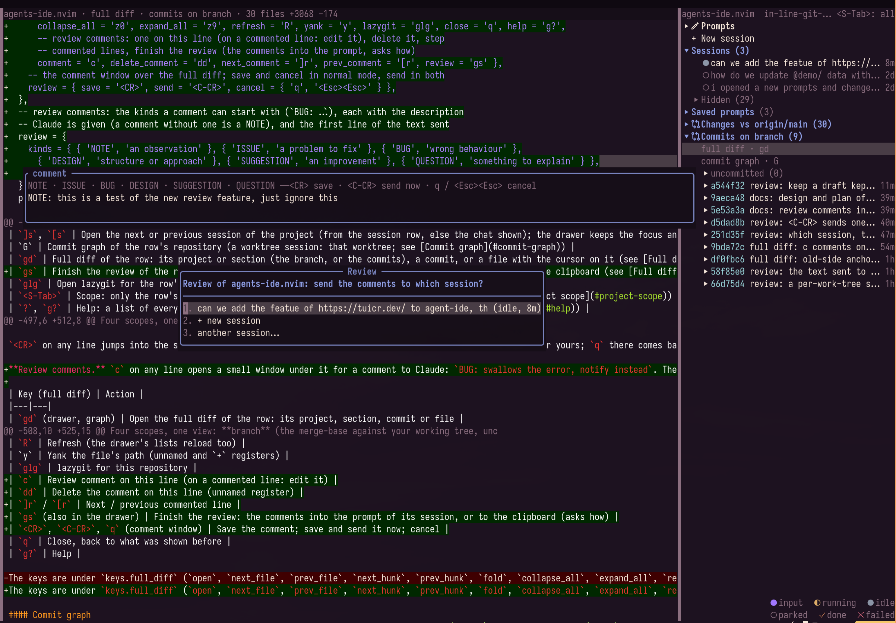
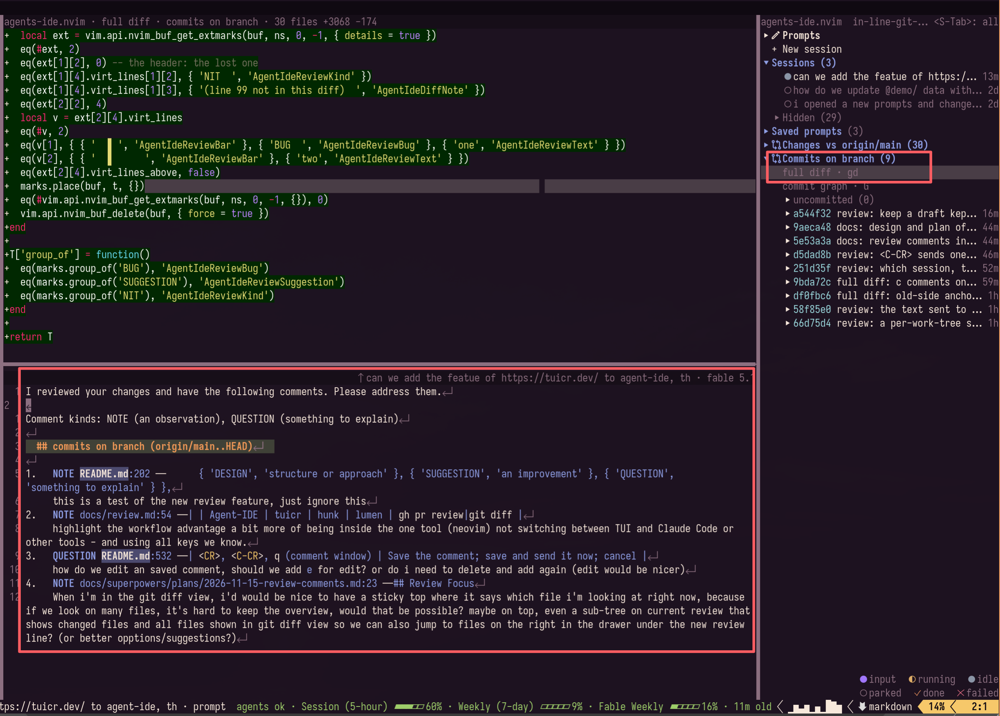

# Reviewing what Claude wrote, without leaving the diff

Agent-IDE shows every change of a branch, a commit or the working tree in one buffer, the [full diff](../README.md#full-diff). This page is about what comes after reading it: telling Claude what to change. You put typed comments on the lines, and the plugin sends them, with the file, the line and the commit, to the session of your choice. No copy, no paste, no terminal switch.

The idea comes from [tuicr](https://tuicr.dev/), a terminal UI for code review that exports its comments as agent-ready markdown. Agent-IDE already drives Claude Code, so the loop closes in place.



## Why inside Neovim

A review tool of its own means a second program: open it, find the change again, type the comments, export, switch to the agent's terminal, paste, and come back to see what it did. Here the diff, the comments, the session's transcript, its prompt and its queue are buffers in one tab. You read the diff with the motions, folds, search and registers you use all day, press `c` where something is wrong, and the comment is already addressed to a session you can see. The review lands in a prompt you can still edit, `<C-CR>` sends it, and the answer streams into the window next to the diff. Nothing is copied, nothing is pasted, no window of another program is in the way, and the keys are the ones you already know.

## The loop

1. **Open a scope.** `gd` on any row of a git project in the drawer: the project row or `Changes` for the branch, the `Commits` section for the uncommitted changes (else the commits), a commit under `Recent commits` or `Commits on branch` for that commit, the `uncommitted` row for the working tree. `:AgentsDiff` opens the branch from anywhere.
2. **Comment.** `c` on a line opens a small window under it. Type `BUG: swallows the error, notify instead` and press `<CR>`. The first word up to the colon is the kind (`NOTE`, `ISSUE`, `BUG`, `DESIGN`, `SUGGESTION`, `QUESTION`, in any case; your own list under `review.kinds`); without one the comment is a `NOTE`. Several lines are fine; `<CR>` in insert mode makes a new one. The comment shows under its line, coloured by kind:

   ```
   +  if not ok then return cb(nil) end
     ┃ BUG  swallows the error, notify instead
   ```

   `c` on a `-` line anchors to the old side, on a file header, a `@@` line or a note to the file as a whole. `c` on a commented line opens the same window with the comment in it, to edit it; `dd` deletes it, `]r` / `[r` step through commented lines.
3. **The session.** The first comment of a review asks where it should go: the chat the full diff was opened over (else the project's most recent session), a new session of the project, or another one from a list. The answer sticks for the review; the editor's winbar and the full diff's winbar name it (`· 3 comments → fix the git runner`).
4. **More scopes.** Close the diff with `q`, `gd` another commit, comment there too. A review is per work tree, across scopes: everything pending goes out together, grouped by where it was made. The drawer shows a `review (n) · gs` row at the top of the project's `Commits` section while comments are pending.
5. **Finish.** `gs` in the full diff (or `<CR>` on that drawer row, or `:AgentsReview` from anywhere in the project) asks: insert the review above the prompt's draft, replace the draft, or copy it to the clipboard. The text lands in the prompt buffer of the session, below the diff, where you add general remarks and send with `<C-CR>` as usual. Or `<C-CR>` inside the comment window sends that one comment at once: queued behind a running turn, else the session starts with the model and mode it would start with anyway.

Comments leave the review once they have gone into the prompt or the clipboard, or when you delete them. They survive a reload of the view (a turn ended, `R`), closing it, and a restart of Neovim; a comment whose line is no longer in the diff sits under its file's header with a note and is still sent with its reference.

## What Claude receives



```
I reviewed your changes and have the following comments. Please address them.

Comment kinds: NOTE (an observation), BUG (wrong behaviour), DESIGN (structure or approach)

## uncommitted changes (working tree against HEAD 7f0f916)

1. **[BUG]** `lua/agent-ide/git.lua:42` — `  if not ok then return cb(nil) end`
   swallows the error, notify instead
2. **[NOTE]** `lua/agent-ide/git.lua:43` — `  if not cb then return end`
   this is fine, but move the guard above the pcall

## commit 60523ec (update images)

3. **[DESIGN]** `README.md` (file)
   the screenshots belong under docs/images, not the root
```

Every reference is filled in from where you pressed `c`: the commit's hash and subject, or which scope (`uncommitted changes against HEAD <hash>`, `branch vs main`, `commits on branch`), the path relative to the repository, the line on the side it exists on (`path:42`, `path:42 (old line)`, `path (file)`), and the line's text, so Claude finds the place even after lines shift. The first line is `review.intro`; the kinds line lists the kinds used with their descriptions.

## Where the comments live

In the plugin's state folder, never in your repository or in `.git`: `stdpath('state')/agent-ide/reviews/<folder>-<hash>.json`, one file per work tree, `0600` in a `0700` folder, written atomically. Several Neovims share it. See [Privacy](../README.md#privacy).

## How it compares

Reviewing a diff with comments that reach an agent is what [tuicr](https://tuicr.dev/), [hunk](https://github.com/modem-dev/hunk) and [lumen](https://github.com/jnsahaj/lumen) do, each as a terminal program of its own. The table states what each project's own README said on 2026-11-15; a cell reads `?` where it said nothing. tuicr publishes a comparison of its own, which this one follows in shape.

| | Agent-IDE | tuicr | hunk | lumen | `gh pr review` | `git diff` |
|---|:---:|:---:|:---:|:---:|:---:|:---:|
| Diff viewer | in Neovim | TUI | TUI | TUI | no | terminal |
| Write comments on lines | yes | yes | ?¹ | yes | no | no |
| Vim keys | yes, your own | yes | via an extension | partial² | no | no |
| The review reaches the agent without copy and paste | yes, into the session's prompt or sent at once | via a `/tuicr` skill or `--stdout`; else copy and paste | via a CLI skill | via `!lumen diff` in the agent | no | no |
| Agent-ready markdown | yes (the prompt text; also to the clipboard) | yes | ? | yes | no | no |
| Push an inline review to a forge | no | GitHub, GitLab, Bitbucket, Azure DevOps | no | no | review-level only³ | no |
| git | yes | yes | yes | yes | no | yes |
| jj | no | yes | yes | yes | no | no |
| Mercurial (hg) | no | yes | no | no | no | no |
| Single static binary | no, a Neovim plugin | yes | a standalone binary; npm needs Node | yes | yes | yes |

¹ hunk's README describes inline AI and agent annotations shown beside the code and a CLI skill through which an agent reads a live hunk session; it does not describe typing comments.
² lumen's README lists `j`/`k` navigation; tuicr's comparison calls it partial.
³ `gh pr review` posts approve, comment or request-changes for the whole pull request, without line comments (tuicr's note).

Agent-IDE does not push reviews to a forge, does not know jj or Mercurial, and is not a program of its own: it needs Neovim and Claude Code.
